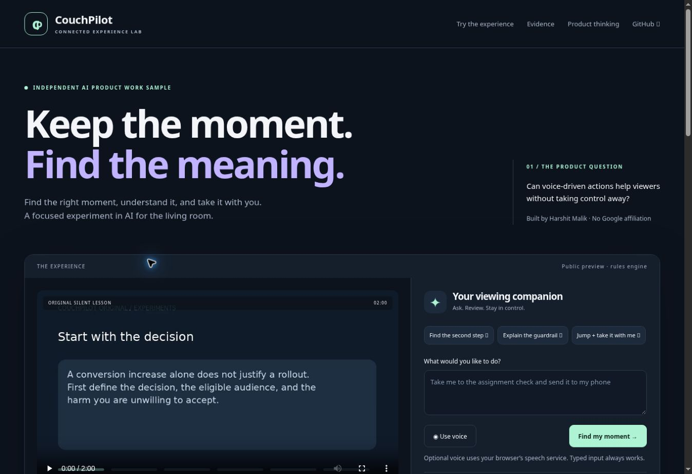

# CouchPilot

**A connected-TV AI product lab: find the right moment, understand it, and take it with you.**

[Try the experience](https://portfolio-lac-five-10.vercel.app/projects/couchpilot/) · [Product brief](docs/PRODUCT.md) · [Architecture](docs/ARCHITECTURE.md) · [Evaluation](docs/EVALUATION.md) · [Limitations](docs/LIMITATIONS.md)

An independent work sample by Harshit Malik for consumer AI product work. No affiliation with Google or YouTube. One original two-minute visual lesson makes every source excerpt and timestamp inspectable. No scraped video or fabricated customer evidence.



[Deployment verification](docs/VERIFICATION.md) records the browser checks and exact tested revision.

## What works

- Play an original silent lesson and navigate six chapters with keyboard or pointer.
- Request a jump, explanation, phone card, or combined jump/card.
- Review source-backed action proposals before changing playback; undo a jump.
- Scan a QR to open the selected public lesson card on a phone and return to its timestamp.
- Inspect measured local-model traces and failures alongside the deterministic baseline.
- Run a bounded local AI workflow with Ollama. It chooses retrieval terms, reads the results, selects actions, and returns a validated proposal. No paid inference API required.
- Exercise a separate loopback-only handoff API with 120-second expiry, one-time consumption and owner revocation.

**The public page runs the rules baseline. Its language-model results are recorded, not live inference.** Optional browser speech recognition requires user permission and may use the browser provider's service. Text input always works; no speech accuracy claim is made.

## Measured result and product decision — upgraded November 19, 2026

| Run | Exact authored tasks | Wrong validated seek proposals | Scope |
|---|---:|---:|---|
| Current rules baseline | **54 / 54** | **0** | Same frozen robustness suite |
| Current local AI workflow (v5) | **54 / 54** | **0** | 38 model-invoked tasks + 16 deterministic boundary decisions |
| Constrained decoder (v4) | 52 / 54 | 0 | Two semantically wrong source selections |
| Prompt + critic (v3) | 42 / 54 | 0 | Ten blocked failures; two wrong source selections |
| Previous model (v2) | 9 / 12 | 1 | Original narrow development suite |
| Initial model (v1) | 2 / 12 | 1 | Initial action contract |

**54/54 is an observed development-suite result, not a universal accuracy or 10/10 quality claim.** The same author wrote the cases and implementation; all cases were visible during development. The current model workflow includes deterministic consent checks and constrained decoding. It is not a measurement of an unconstrained model. Every earlier failure is preserved in the evaluation explorer and repository.

**Release the inspectable prototype; keep production AI on hold.** Rules also pass 54/54 and have negligible inference overhead. No incremental user benefit from AI has been demonstrated. Model selection remains meaningful on multiple retrieved candidates, but an explicit chapter target can leave only one permitted source and action. That restriction is intentional and disclosed.

## What changed in this upgrade

- **Request-specific output constraints:** the model can select only consented tools and retrieved source IDs; a deterministic critic verifies every proposal, with at most one repair.
- **Fresh approval:** edits, cancellation and chapter changes invalidate old proposals. Approval is single use; a late response cannot resurrect a cancelled request.
- **Clarification recovery:** choose a source chapter to prepare a fresh proposal without moving playback.
- **TV focus mode:** larger controls, visible focus, directional keyboard navigation, explicit play/pause and a complete readable transcript.
- **Evidence explorer:** compare five measured model iterations, filter task categories/failures, and inspect traces including deterministic boundary decisions.
- **Device layout lab:** inspect the actual page in 360, 768 and 1280 pixel browser viewports, plus the phone companion.
- **Trustworthy event attribution:** cancellation and undo retain the correct task identity; exports omit prompt and audio fields.
- **48 automated tests** (29 Python, 19 JavaScript), source/report integrity gates, SQL reconciliation, and software decoding of all six shipped QR assets.

## Run without inference

Python 3.11+ and Node 20+; no runtime packages required for the prepared static app.

```sh
python -m unittest discover -s tests -v
node --test tests/test_engine.mjs
python scripts/verify_analytics.py
python scripts/verify_reports.py
python scripts/build_web.py
python -m couchpilot.server
```

Open `http://127.0.0.1:8787`. The default experience uses rules. Server binds to loopback, so it is not a public or LAN service. The public QR works on a phone because it opens the published companion card; the local single-use API is separate.

## Run actual local AI

Install Ollama from its official source, start its local service and download the model. Model weights are separate and subject to their own license. Hardware, memory, electricity and downloads are resources even without an API bill.

```sh
ollama pull qwen2.5:3b
python -m couchpilot.server --model qwen2.5:3b
# Enable “Use local Ollama model” in the local app.
python -m couchpilot.evaluate --model qwen2.5:3b --output evaluation/my-local-run.json
```

The application calls only `127.0.0.1:11434`. Model unavailability produces a visible error; it never silently substitutes the rules policy. The evaluator defaults to the 54-case authored suite and writes progress after each case. Use a fresh filename for a new trial; the command does not resume interrupted runs. Tests use explicit model doubles and do not count as model-quality measurements.

## Contents

- `couchpilot/core.py`: retrieval, local model adapter, action validation and reference policy.
- `couchpilot/server.py`, `pairing.py`: loopback API and bounded single-use handoff.
- `web/`: static TV interface, original video, companion and recorded evidence.
- `evaluation/`: frozen task definitions, all five model reports, source snapshots and QR decode evidence.
- `analytics/`: task-level SQL funnel; verification uses labeled synthetic rows.
- `docs/`: strategy, experiment plan, traceability, risks and release decision.

Rebuild the original media with Pillow and ffmpeg using `python scripts/build_media.py`. Rebuild QR assets with qrcode 8.2 using `python scripts/build_qr.py`. These are optional asset-build dependencies, not app runtime requirements. Media generation is not byte-identical across encoder versions.

## Evidence boundaries

No native YouTube integration, device/OEM launch, real customer research, production-scale serving, guaranteed privacy on shared TVs, measured adoption or revenue impact. The public card contains only original public content; it is shareable and has no expiry. The original lesson and transcripts are released under CC0-1.0; code is MIT. Third-party runtimes/models retain their own licenses and are not redistributed.

The 54-case suite contains 53 unique request/context pairs: “Explain this part” at the uncertainty chapter appears once in the original suite and once in the expanded context sweep. Both recorded cases remain visible; they are not independent observations.
