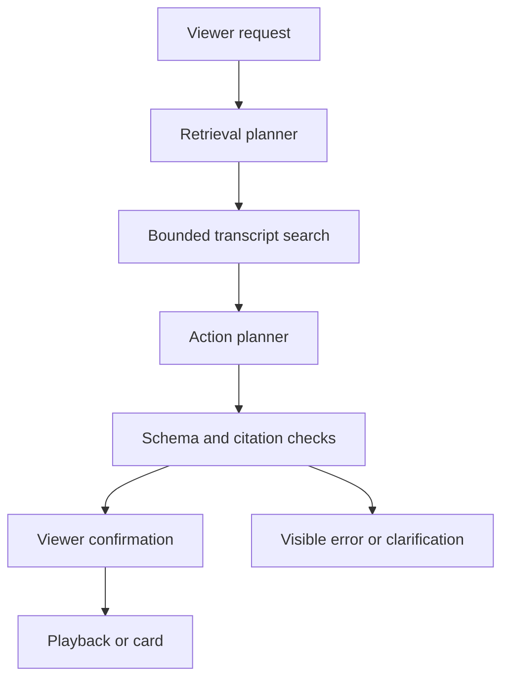

# Architecture and boundaries

## Two distinct execution paths
The public page runs a deterministic JavaScript baseline. Its local-model results are recorded evidence, explicitly labeled. The Python local server uses Ollama's chat API: model-selected search terms → executed retrieval → model-selected action → validated proposal. This is a bounded workflow with two normal model calls and at most one repair call. Deterministic request boundaries can clarify or reject without calling a model. It is not open-ended autonomy. The small model is not asked to invent an answer: excerpts and times are resolved from the canonical source after a cited segment is selected. Correct source selection is still an empirical quality question.

Before generation, the host compiles the requested tool set and retrieved source IDs into the output schema. This host enforcement is not a claim that the model independently understands consent. The action prompt contains source excerpts and a resolved target only where needed; unrelated current-playhead context was removed after measured source-selection errors. A deterministic critic checks the result and permits at most one repair. A model proposal cannot invoke arbitrary code or a URL. Allowed intents map to seek, explain and prepare_card tools. Invalid fields, duplicate tools, unknown or unretrieved sources, or conflicting targets fail closed. Public UI validates returned timestamps and excerpts again before asking for approval. Playback does not change just because the model responded. ReviewSession ties a proposal to its query, source context and revision. Edits, cancellation and chapter changes invalidate pending work; single-use approval rejects stale or duplicate application. SessionLog keeps task IDs separate from cancellation revisions so recovery events reconcile correctly.

## Handoff types
Public: a QR/link opens a companion page using only the original public lesson's segment ID. No user identifier or private data; no expiry, revocation or actual pairing is claimed. QR URLs point to the published portfolio, so a locally generated card still leads to the public lesson.

Local API: random 192-bit bearer code, 120-second TTL, one-time consumption, owner-token revocation and synchronized consumption. These are local integration-testable mechanisms. The server binds only to loopback and is not a deployable authenticated cross-device service; a phone on another device cannot reach it. No pairing claims are made for the public demo. A production relay would need TLS, secure channel establishment, rate limits, server-side expiry, access controls and explicit user disclosure.

## Privacy and security
No API keys. Local inference only calls 127.0.0.1. No shell tools. HTTP endpoints enforce Host/Origin, JSON content type and a 4 KB body limit. Only one inference runs at a time. Logs omit prompts and handoff codes. Session event export excludes prompts and audio. The browser's optional Web Speech service may send audio to its provider; it is opt-in and not described as on-device speech processing. No audio is stored by this application.

Prompt injection resistance is not established by schema restrictions alone. An adversarial request can still induce an incorrect allowed action. Human confirmation, source selection checks, limited tools and visible evidence reduce consequences; adversarial evaluations and privacy review remain necessary. Local HTTP server is a development host, not production infrastructure.

## Content
The lesson text and rendered silent MP4 are original fixtures. `scripts/build_media.py` uses Pillow and ffmpeg to render six 20-second chapters. The MP4 is embedded in media.js to keep static deployment self-contained. No speech/audio model or YouTube video understanding is claimed. The native HTML video can play, pause and seek; the returned excerpt is the authored transcript.

## Reproduction
Python 3.11–3.13 and Node 20+ suffice for tests and the prepared web assets. Optional model path needs Ollama and qwen2.5:3b. Exact model digest and runtime metadata are retained in the measured report. Model weights and Ollama are not redistributed. Ollama API documentation: https://docs.ollama.com/api/chat ; model license information: https://ollama.com/library/qwen2.5:3b .
