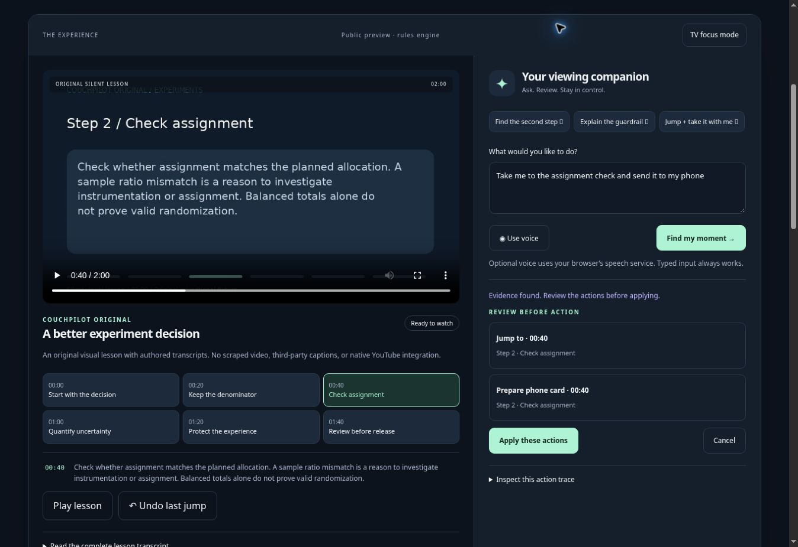

# Published upgrade verification

Verified November 19, 2026 (America/New_York) against the public Chrome browser experience.

- CouchPilot application revision: `07001dc14e7fe16eee35e7f2330f4d98916e6059`.
- Portfolio main: `8a36cc24bafc04a3211cb54cb934c203ba6cc849`; published branch: `24d5ef1ef7c855bd2513fd6409656b362765d160`.
- [Application CI passed](https://github.com/harshit-malik-nyu/couchpilot/actions/runs/44626193448): 29 Python tests, 19 JavaScript tests, source/report integrity, SQL reconciliation, generated-asset consistency, JavaScript syntax and all six software QR decodes. The Python matrix covers 3.11–3.13.
- [Live experience](https://portfolio-lac-five-10.vercel.app/projects/couchpilot) · [Device layout lab](https://portfolio-lac-five-10.vercel.app/projects/couchpilot/device-lab).

## Observed interaction results

| Journey | Observed result |
|---|---|
| Edit a pending jump into a phone-card request | Old proposal disappeared; playback remained at zero; fresh card-only approval did not seek |
| Request an unspecified step | Explicit chapter choices appeared; selecting assignment prepared a fresh 40-second proposal without moving playback |
| Approve the clarified jump | Player moved to 40 seconds |
| Cancel a subsequent review request, then undo | Player returned to zero; undo was attributed to the applied task, not the later cancelled task |
| TV focus mode and directional keyboard navigation | Controls enlarged; ArrowRight moved focus to assignment; Enter selected the 40-second chapter |
| Open the assignment phone companion | Canonical excerpt and 40–60 second source range appeared |
| Return from the companion | Player initialized at 40 seconds, with 120-second duration and no media error |
| Filter latest workflow to failures only | No matching tasks |
| Filter prompt-plus-critic historical workflow to failures only | All 12 historical failures appeared |
| Filter latest workflow to paraphrase | Five rows appeared; every row showed its starting chapter |
| Navigate from experience to evidence and back | After the navigation fix, 40-second playback, typed request, pending approval and five-row paraphrase filter were preserved |

The final navigation check caught a real deployment issue: the asset directory base resolved fragment links to a trailing-slash URL, which redirected and reloaded the page. Section links now retain the exact current document path, preserving the session while leaving native fragment navigation intact.

## Responsive layout checks

The lab loads the real public page inside fixed browser viewports. The content widths below include the browser's 15-pixel scrollbar deduction. At each tested size, document content width equalled the viewport width; there was no document-level horizontal overflow.

| Preview | Frame width | Document client width | Document scroll width |
|---|---:|---:|---:|
| Phone | 360 | 345 | 345 |
| Phone companion | 360 | 345 | 345 |
| Tablet | 768 | 753 | 753 |
| TV browser | 1280 | 1265 | 1265 |

Initial phone verification found the evaluation select forcing horizontal overflow. The fix makes the filter grid and select controls shrink to the available width. A wide evidence table can scroll within its own container.

## Browser event reconciliation

[evaluation/browser-events.json](../evaluation/browser-events.json) contains 18 events exported through the public UI during the scripted review/edit/clarify/apply/cancel/undo walkthrough. The checked SQL output was:

| Initiated tasks | Ready proposals | Applied tasks | Applied, not undone | Cancelled tasks |
|---:|---:|---:|---:|---:|
| 5 | 4 | 2 | 1 | 2 |

The final undo belongs to task 4 even though task 5 had subsequently been cancelled. No raw prompts, query text or audio fields were exported. This is an automated QA walkthrough, not an independent person, product adoption study or viewer conversion measurement. `applied_not_undone` is only an event proxy.

## Measured AI evidence

The unchanged v5 report records 54/54 exact authored cases (53 unique query/context pairs), with zero wrong validated jumps and zero source-fidelity failures. Thirty-eight tasks invoked the local model; sixteen were policy-only. The rules baseline also passed 54/54. Tests of this same visible development set do not establish independent generalization or incremental AI value. All prior reports and failure traces remain available.

## Screenshot and limits

The screenshot is an unedited capture of the deployed page after the session-preservation fix. The player was manually set to assignment before the proposal, so the screenshot is not evidence of unapproved execution.

These are browser smoke and CSS layout checks, not physical device certification. No physical TV remote, phone camera, microphone, speech accuracy or screen reader was tested. QR assets were decoded in software; that does not prove real-camera compatibility. The public site runs rules. Local-model reports describe actual local inference performed separately; the site does not run a hosted language model. No production-scale operation, real viewer benefit or customer adoption is claimed.

---

# Historical verification — November 18, 2026

Verified November 18, 2026 (America/New_York), on the public Chrome desktop experience.

- Application revision: `25862d7a9fba26924a01e671c1541eef101beb82`.
- [Repository CI passed](https://github.com/harshit-malik-nyu/couchpilot/actions/runs/44439026189): 20 Python tests and 7 JavaScript tests, across Python 3.11–3.13; JavaScript syntax, SQL funnel reconciliation and generated-asset consistency checks.
- Portfolio deployment includes the project as the first selected-work card and in the role evidence page.
- [Live experience](https://portfolio-lac-five-10.vercel.app/projects/couchpilot).

## Observed browser results

| Journey | Result |
|---|---|
| Open from the portfolio's CouchPilot card | Published page, chapter controls and evaluation loaded |
| Start the original lesson | Video played; duration 120 seconds; no media error |
| Request assignment check plus phone card | Review showed two actions sourced to 00:40; playback stayed unchanged until approval |
| Apply reviewed actions | Player moved to 40 seconds and the assignment companion card appeared |
| Undo the jump | Player returned to its previous position, 0 seconds |
| Open companion link | Assignment excerpt and 40–60 second source range appeared |
| Return from the companion | Player initialized at 40 seconds |
| Inspect public evaluation | Displayed rules 11/12, local model 9/12 and one wrong-seek proposal |

The screenshot is an unedited capture of the deployed page, not a design mockup.

## Limits of this verification

These observations are a desktop browser smoke check, not a cross-device usability study. No physical TV, phone camera scan, screen reader or microphone permission was exercised. The companion hyperlink was tested; QR decoding on physical devices remains unverified. The deployed app uses the deterministic rules baseline. The local-model evaluation and its failures are recorded separately in `evaluation/`. Passing engineering tests does not establish model quality, user value or production readiness.
